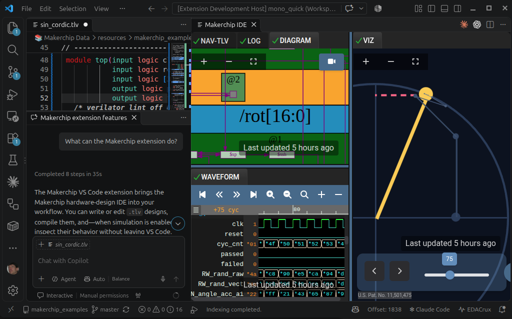

# Makerchip Extension

VS Code extension for Makerchip IDE integration and AI-collaborative Verilog/TL-Verilog development, debug, and visualization.

## Features

- **Compile/Simulate Verilog, TL-Verilog, and Other HDLs**: Compile and visualize circuit simulations directly in VS Code
- **AI Agent Integration**: Language Model tools enable AI agents to work interactively in Makerchip with designers and learners
- **AI RAG Knowledge Base**: AI Agents are upskilled for TL-Verilog and Makerchip development

## Before You Begin

> This extension is early, experimental software, provided **as is**, without warranty of any kind. Features, tools and settings may change or disappear without notice. Expect rough edges, and please [report them](https://github.com/rweda/makerchip-vscode-extension/issues) or submit pull requests.
>
> **Makerchip is built for open-source development only.** Your code is compiled on Makerchip servers and communication is insecure. **Do not share proprietary code or sensitive information.** Various features including third-party plugins may exchange data with third-party servers. **Develop with trusted code only.**
>
> **Terms.** Your use of the Makerchip service is governed by the Makerchip [Terms of Service](https://makerchip.com/terms/) and [Privacy Policy](https://makerchip.com/privacy/). The extension itself is MIT-licensed and provided as is (see [License](#license)). To the fullest extent permitted by law, Redwood EDA, LLC accepts no liability for any loss or damage arising from its use.

## Requirements

- VS Code 1.110.0 or higher
- GitHub Copilot or Microsoft's Claude/Codex harness (for AI features)

## Usage

### Manual Usage

**Compiling, Simulating, and Debugging:**
1. Open a `.tlv` file
2. Press `Ctrl+Shift+Enter`, click the Makerchip icon, or run "Makerchip: Compile/Simulate" from the command palette. (Use "Makerchip: Compile/Simulate in Panel..." to select or create named panels.)
3. View compilation results, circuit diagrams, and waveforms in the webview panel

### With AI Agents

AI Agents can:
- Author, compile, and visualize TL-Verilog files directly in Makerchip
- Create custom visualizations (Visual Debug) to explain its work
- Layout and activate the IDE views
- Author and load third-party content into Makerchip views that interacts with the IDE
- Highlight signals, scopes, and pipeline stages to guide exploration

Example prompts:
- "Show me a simple counter in Makerchip"
- "Open this CPU in Makerchip and show the waveform and live logic diagram at cycle 20, highlighting signals related to the bypass logic."
- "Demonstrate a pipeline design in TL-Verilog"
- "Create a tic-tac-toe game in TL-Verilog with VIZ and show it in Makerchip"
- "Which signal are you talking about?"
- "I'm having trouble understanding 'when' conditions. Create a simple course with exercises to step me through it and open it in Makerchip."

## Agent Resources

The extension manages `~/.vscode-makerchip/` containing reference data for AI assistants:
- **resources/**: Documentation, examples, and specifications
- **skills/**: AI agent skills including [tlv-ecosystem.md](resources/skills/tlv-ecosystem.md)
- **compile-cache/**: Compilation results for debugging - see [compile-cache/README.md](resources/compile-cache-README.md)

## Contributing

Development setup, the `./launch` workflow, the Copilot tool architecture and the release process are in [CONTRIBUTING.md](CONTRIBUTING.md).

## License

[MIT](LICENSE) © Redwood EDA, LLC
